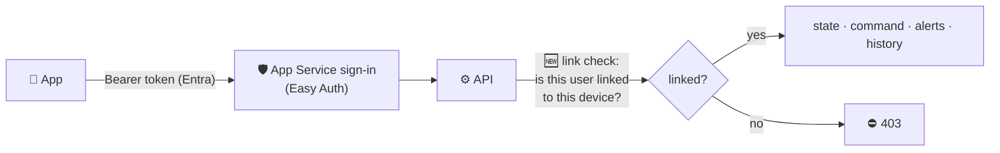

# 🔌 Pilot API contract — app ↔ EMS-1000 API

> **Status:** DRAFT v0.1 (2026-11-23) — to be agreed in P0 (Okey + Paul).
> **Source of truth for existing endpoints:** `ems1000-staging/src/api/main.py` (API v1.1.0). This doc describes how the **app** uses them and what's **new**.

## At a glance



| Legend | Meaning |
|---|---|
| ✅ Exists | Already in the staging API — app uses as-is |
| 🔧 Change | Exists, needs a backend change for the app |
| 🆕 New | Must be built in `ems1000-staging` (milestone shown) |

## Endpoints the app uses

| | Method & path | App screen | Milestone |
|---|---|---|---|
| ✅ | `GET /api/whoami` | Settings (who's signed in) | — |
| 🆕 | `GET /api/me/devices` | My generators | P1 |
| 🔧 | `GET /api/devices/{id}/state` | My generators, Generator detail | P1 (add link check) |
| 🔧 | `POST /api/devices/{id}/command` | Start / Stop / Reset fault | P1 (link check + command log) |
| 🆕 | `GET /api/devices/{id}/history?hours=24` | 24 h chart | P4 |
| 🔧 | `GET /api/alerts?device_id=…` | Alerts | P3 (add device-fault alerts, filter to my devices) |
| 🆕 | `GET` / `PUT /api/me/alert-prefs` | Settings → Alerts | P3 |
| 🆕 | `POST` / `DELETE /api/me/push-tokens` | (background) push registration | P3 |

Not used by the app (admin / web panel): `/api/access`, `/api/devices/{id}/twin*`, `/api/devices/{id}/telemetry`, `?live=true` (costs IoT Hub messages).

---

## 🔐 Authentication

- The app signs the user in with Microsoft (Entra, this tenant only) and sends `Authorization: Bearer <access token>` on every call.
- App Service sign-in (Easy Auth) validates the token and passes the user to the API. The API already understands this (`access.py`, `kind: "entra"`).
- `X-API-Key` stays for machines (simulator panel). **The app never holds an API key.**

🆕 **Backend work (P1):**
1. Expose an API scope on the API's app registration (e.g. `api://<api-client-id>/access_as_user`).
2. Add the scope's audience to Easy Auth's allowed token audiences.
3. Register the mobile app as a public client (redirect URI for Expo), allowed to request that scope.

---

## 🆕 Device link check (P1)

Every `/api/devices/{id}/…` call from a **signed-in person** checks the `UserDevices` table:

| Caller | Linked to device? | Result |
|---|---|---|
| Entra user | yes | allowed |
| Entra user | no | `403 {"detail": "You don't have access to this device."}` |
| API key (panel/sim) | n/a | allowed (admin) |

`UserDevices` table — PartitionKey = user's Entra object id, RowKey = device id:

```json
{ "PartitionKey": "<entra-oid>", "RowKey": "ems-sim-01",
  "nickname": "Office generator", "role": "operator",
  "linked_by": "okey@…", "linked_at": "2026-11-25T10:00:00Z" }
```

`role` is stored but **not enforced in the pilot** (decision 0005). Linking is done with `scripts/link_user_device.py` in `ems1000-staging`.

---

## Endpoint details

### 🆕 `GET /api/me/devices`
```json
{
  "count": 1,
  "devices": [
    { "device_id": "ems-sim-01", "nickname": "Sim generator", "role": "operator",
      "run_state": "Running", "fuel": 72, "faults": [], "warnings": [],
      "connection_status": "Online", "age_s": 34 }
  ]
}
```
Summary fields come from the same `DeviceState` row as `/state`, so the list needs only one call.

### 🔧 `GET /api/devices/{id}/state` (existing reply shape)
```json
{
  "device_id": "ems-sim-01",
  "source": "stored",
  "received_at": "2026-11-23T14:02:11+01:00",
  "age_s": 34,
  "readings": { "v": 229.8, "i": 6.1, "f": 50.0, "fuel": 72, "oil": 0, "oil_state": "ok",
                "t": 78.5, "vb": 13.6, "soc_pct": 100, "soc_reliable": false, "load_pct": 44.9 },
  "status":   { "run": 2, "run_state": "Running", "flt": 0, "faults": [], "warnings": [] },
  "link":     { "rssi": -71, "connection_status": "Online",
                "last_status_change": "2026-11-23T09:00:02+01:00", "seq": 812, "sv": 1 }
}
```

**How the app uses it**

| App element | Field(s) | Rule |
|---|---|---|
| 🟢🟡🔴 State chip | `status.run_state`, `status.faults` | Running = green · Cranking/Stopping = amber · Fault = red · Off = grey |
| 📶 Offline badge | `age_s`, `link.connection_status` | **Offline** if `connection_status == "Offline"` or `age_s > 180` (3 heartbeats); shows "updated X ago" |
| ⛽ Fuel tile | `readings.fuel` | % with bar; amber below 25, red below 10 (display only — device decides the fault) |
| 🛢️ Oil tile | `readings.oil_state` | ok / low / critical |
| 🌡️ Temp tile | `readings.t` | °C |
| 🔋 Battery tile | `readings.vb`, `soc_pct`, `soc_reliable` | Show % only when `soc_reliable` is true; otherwise volts |
| ⚡ Power tiles | `v`, `i`, `f`, `load_pct` | V, A, Hz, load % |
| ⚠️ Warnings | `status.warnings` | voltage / frequency out of range |

Times arrive in **WAT (UTC+1)**; the app shows them as relative time ("2 min ago") and local clock time.

### 🔧 `POST /api/devices/{id}/command`
Request (existing shape):
```json
{ "command": "start" }        // start | stop | reset_fault
```
Replies (mirrors the device):

| HTTP | Meaning | App shows |
|---|---|---|
| 200 | Accepted | "Starting…" then polls `/state` every 3 s for up to 30 s |
| 400 | Refused, e.g. already running | Device's reason |
| 409 | Safety check failed / fault still present | Device's reason (e.g. "low oil") in red |
| 403 | 🆕 Not linked to this device | "You don't have access to this generator" |
| 502 | Device error | "The generator reported an error" |
| 504 | Offline / no answer in 15 s | "Generator didn't respond — check it's online" |

🆕 Every call (any result) writes a `CommandLog` row: who, device, command, HTTP status, device reply, time. Not shown in the pilot app.

**App rules:** Start/Stop buttons are **disabled** when offline, when a command is in flight, or when the state makes them meaningless (Start while Running, Stop while Off). A confirm dialog comes before Start and Stop. No commands are queued while offline (decision 0008).

### 🆕 `GET /api/devices/{id}/history?hours=24`
Downsampled for small payloads (one point per 5 minutes = up to 288 points):
```json
{ "device_id": "ems-sim-01", "hours": 24, "step_s": 300,
  "points": [ { "t": "2026-11-23T14:00:00+01:00", "fuel": 72, "v": 229.6, "temp": 78.1, "run": 2 } ] }
```
Why new: `/telemetry` returns at most 500 raw messages, which isn't 24 h at a 60 s heartbeat.

### 🔧 `GET /api/alerts?device_id=…&status=all&limit=50` (existing reply shape)
```json
{ "count": 1, "alerts": [
  { "id": "…", "device_id": "ems-sim-01", "rule": "low_oil", "severity": 0,
    "status": "active", "description": "Critical oil level — generator locked out",
    "source": "device-fault", "fired_at": "2026-11-23T14:05:00+01:00", "resolved_at": null } ] }
```
🆕 P3 changes:
- `telemetry_ingest` (Function) compares each message's `flt` with the previous one. When a fault bit sets it writes an `Alerts` row with `source: "device-fault"`; when it clears, the row is resolved. It then triggers push to linked users whose prefs allow that alert.
- For signed-in users, `/api/alerts` only returns alerts for their linked devices.
- Existing Azure Monitor alerts (missing telemetry = device offline) also trigger push.

| Fault bit | `rule` | Push default |
|---|---|---|
| bit0 | `low_oil` | 🔔 on |
| bit1 | `low_fuel` | 🔔 on |
| bit2 | `over_temperature` | 🔔 on |
| bit3 | `low_battery` (crank failed) | 🔔 on |
| bit4 | `voltage` (warning) | 🔕 off |
| bit5 | `frequency` (warning) | 🔕 off |
| — | `device_offline` (Azure Monitor) | 🔔 on |

### 🆕 `GET` / `PUT /api/me/alert-prefs`
```json
{ "low_oil": true, "low_fuel": true, "over_temperature": true, "low_battery": true,
  "voltage": false, "frequency": false, "device_offline": true }
```
`PUT` accepts any subset; unknown keys → 400.

### 🆕 `POST /api/me/push-tokens` · `DELETE /api/me/push-tokens/{token}`
```json
{ "token": "ExponentPushToken[xxxxxxxx]", "platform": "android", "app_version": "0.1.0" }
```
Called after sign-in and whenever Expo issues a new token; `DELETE` on sign-out. Tokens that Expo reports as invalid are removed automatically.

---

## Polling budget (pilot)

| What | When | Interval |
|---|---|---|
| `/me/devices` | My generators screen open | 30 s |
| `/state` | Generator detail open | 15 s |
| `/state` | After a command | 3 s for up to 30 s |
| `/alerts` | Alerts screen open / app resumed | on open |
| `/history` | Detail screen open | on open + every 5 min |

All of these read Table Storage, not the device, so they **don't use the IoT Hub message budget**. Polling stops when the app is in the background.

## Open points for P0
- [ ] Paul: confirm fault bits and `rule` names match firmware.
- [ ] Confirm the 180 s offline threshold against the heartbeat interval (60 s).
- [ ] Device nickname: set at link time (script) or editable in app later?
