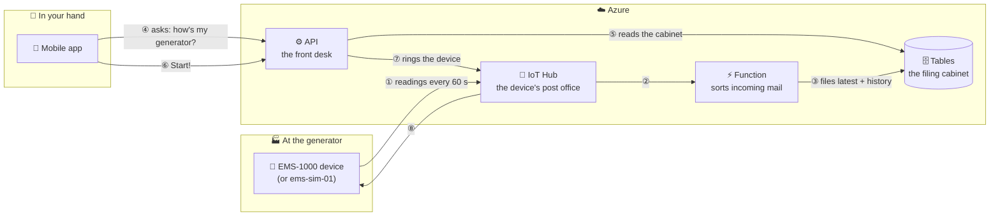
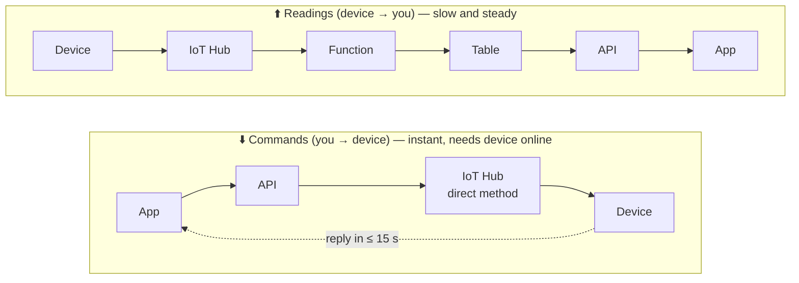

# L1 — How the whole system fits

> ⏱️ ~7 min read · Arrives with: P0 · Last checked against code: 2026-11-23 (`ems1000-staging` API v1.1.0)

## 🖼️ The picture

**One sentence:** the device posts readings to IoT Hub, a Function files them in tables, and the app reads those tables through the API. Commands go the other way: app → API → IoT Hub → device.

## 🎯 The 20% that matters

### 1. Six pieces, one job each

| | Piece | Analogy | Job | Lives in repo |
|---|---|---|---|---|
| 🤖 | Device / simulator | The generator's voice | Measures, sends readings, obeys commands | firmware (Paul) · `ems1000-device-sim` |
| 📡 | IoT Hub | Post office | Receives device messages; delivers commands; knows if a device is connected | `ems1000-staging` (Terraform) |
| ⚡ | Function App | Mail sorter | Turns each message into a "latest" row and a history row; spots offline devices | `ems1000-staging/src/function` |
| 🗄️ | Table Storage | Filing cabinet | `DeviceState` (latest), `DeviceTelemetry` (history), `Alerts`, … | `ems1000-staging` (Terraform) |
| ⚙️ | API (App Service) | Front desk | The **only** door the app uses; checks who you are; reads tables; sends commands | `ems1000-staging/src/api` |
| 📱 | Mobile app | Your remote control | Shows state, sends Start/Stop, shows alerts | **this repo** |

### 2. Two directions, two speeds

- **Readings** arrive about every 60 s. The app **reads the table**, so it works even when the device is offline. It just shows older data with an "updated X ago" badge.
- **Commands** are a live phone call to the device (an IoT Hub *direct method*). If the device is offline, the call fails within 15 s (`504`). Nothing is queued, so a late "Start" can never surprise anyone.

### 3. The app never talks to the device directly

Everything goes through the API. That gives us one place to:
- 🔐 check **who** you are (Microsoft sign-in)
- 🔗 check you're **linked** to that generator
- 📝 **log** every command

### 4. "Fresh" vs "stale" is just arithmetic

The API returns two separate facts, and the app uses them for different things:

| Fact | Comes from | App shows | Controls Start/Stop? |
|---|---|---|---|
| `age_s`: seconds since the last reading | Table Storage | "updated X ago" (greys after 150 s) | ❌ No |
| `connection_status`: Online / Offline | IoT Hub connect/disconnect events | **Offline** badge | ✅ Yes: disabled when Offline |

Why separate? Old data can mean a slow pipeline while the device is still connected, and commands would still work. A disconnected device can't take commands at all.

### 5. Messages cost money; reads don't

IoT Hub's free tier allows ~8,000 device messages a day, and the simulator has a budget guard. The app's polling reads **tables**, which costs practically nothing. That's why the app avoids `?live=true` (which phones the device).

## 🧭 What you'd touch

| You want to… | Look at |
|---|---|
| Change what a screen shows | this repo → `app/…` (from P2) |
| Change what the API returns | `ems1000-staging/src/api/main.py` |
| Change how readings are filed or alerts raised | `ems1000-staging/src/function/function_app.py` |
| Add a table, change IoT Hub or alerts infra | `ems1000-staging/infra/…` (Terraform → HCP plan → you apply) |
| Make the simulator misbehave on purpose | `ems1000-device-sim/config/scenarios/*.yaml` |
| Know the exact request/reply shapes | [`docs/api/pilot-api-contract.md`](../api/pilot-api-contract.md) |

## ⚠️ Common traps

- **"The app shows old data, so the app is broken."** Usually the device or simulator isn't sending. Check `age_s` and `connection_status` first.
- **"Start returned 504."** The device is offline or didn't answer in 15 s. It's not an app bug.
- **"Start returned 409."** The device refused for safety (e.g. low oil). Working as designed; the reason is in the reply.
- **Times look an hour off.** The API replies in WAT (UTC+1); storage is UTC. The app converts for display.
- **Testing with `?live=true` in a loop** burns the daily IoT Hub message budget.
- **Sending start/stop any other way than a direct method** (e.g. a device-twin setting) means it could fire when the device reconnects, possibly much later. Not allowed ([decision 0011](../decisions/README.md)).

## 📖 Go deeper

- [Azure IoT Hub overview](https://learn.microsoft.com/azure/iot-hub/iot-concepts-and-iot-hub): what the "post office" does
- [IoT Hub direct methods](https://learn.microsoft.com/azure/iot-hub/iot-hub-devguide-direct-methods): how Start/Stop calls work, including timeouts
- [Azure Table Storage](https://learn.microsoft.com/azure/storage/tables/table-storage-overview): the "filing cabinet"
- [App Service authentication (Easy Auth)](https://learn.microsoft.com/azure/app-service/overview-authentication-authorization): how the API knows who you are
- [Expo documentation](https://docs.expo.dev/): the toolkit the app is built with
