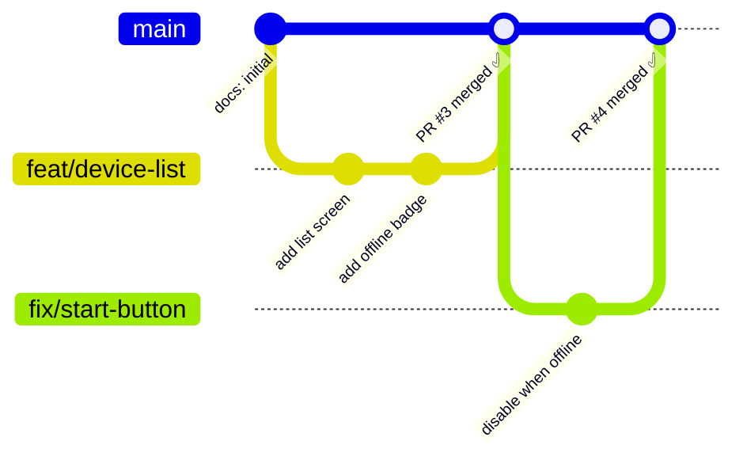
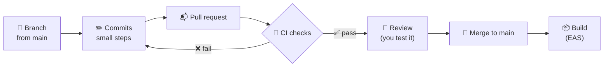

# L7 — Git workflow: branch → PR → CI → merge

> ⏱️ ~6 min read · Arrives with: P0 · Same flow you already use in `ems1000-staging`

## 🖼️ The picture





## 🎯 The 20% that matters

1. **`main` is always working.** Nobody commits straight to it; changes arrive only through a pull request (PR).
2. **One branch = one change.** Name it by type: `feat/…` (new feature), `fix/…` (bug), `docs/…`, `chore/…` (tooling).
3. **The PR is the conversation.** It shows exactly what changed, why, and how to test it. Your job as tester: install the build or preview, try it, then approve or comment.
4. **CI is the robot reviewer.** On every PR, GitHub Actions runs type-check, lint and tests. Red = don't merge.
5. **Commit messages say what and why:** `feat: grey out "updated X ago" after 150 s`, not `update`.

## 🧭 What you'd touch

**Mostly the GitHub website. No terminal needed for your role:**

| You want to… | Where on GitHub |
|---|---|
| See what's waiting for you | Repo → **Pull requests** tab |
| See what changed | PR → **Files changed** |
| See why a check failed | PR → **Checks** → click the red ❌ → read the log |
| Approve | PR → **Files changed** → **Review changes** → Approve |
| Merge | PR → **Squash and merge** (keeps `main` history tidy) |
| Fix a typo in a doc yourself | Open the file → ✏️ pencil icon → "Create a new branch and start a pull request" |

**If you do use a terminal (Codespace):**

```bash
git switch main && git pull          # start from latest main
git switch -c docs/fix-typo          # new branch
# …edit files…
git add -A && git commit -m "docs: fix typo in L1"
git push -u origin docs/fix-typo     # then open the PR link GitHub prints
```

## ⚠️ Common traps

- **Working on an old `main`:** always `git pull` before branching, or merges get conflicts.
- **Huge PRs:** hard to test, hard to review. Aim for one screen or one endpoint per PR.
- **Secrets in commits:** never commit `.env` files or keys. If it happens, rotate the key; deleting the file isn't enough, because Git keeps history.
- **Merging with red checks:** the build will likely break for everyone.

## 📖 Go deeper

- [GitHub flow](https://docs.github.com/get-started/using-github/github-flow): the official one-page version of this workflow
- [About pull requests](https://docs.github.com/pull-requests/collaborating-with-pull-requests/proposing-changes-to-your-work-with-pull-requests/about-pull-requests)
- [Reviewing changes in a PR](https://docs.github.com/pull-requests/collaborating-with-pull-requests/reviewing-changes-in-pull-requests/reviewing-proposed-changes-in-a-pull-request)
- [About protected branches](https://docs.github.com/repositories/configuring-branches-and-merges-in-your-repository/managing-protected-branches/about-protected-branches): how to lock `main`
- [Conventional Commits](https://www.conventionalcommits.org/): the `feat:` / `fix:` naming style
