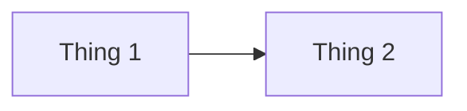

# Lx — <Topic>

> ⏱️ ~5 min read · Arrives with: Px · Last checked against code: YYYY-MM-DD

## 🖼️ The picture

## 🎯 The 20% that matters

1. **Idea one**: one or two sentences.
2. **Idea two**
3. **Idea three**

## 🧭 What you'd touch

| You want to… | Look at |
|---|---|
| | `path/to/file` |

## ⚠️ Common traps

- Trap: what happens, how to avoid it.

## 📖 Go deeper

- [Official doc title](https://example.com): what you'll find there
