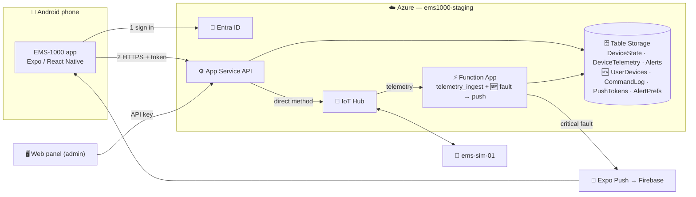
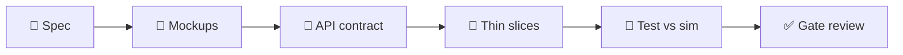

# 🗺️ EMS-1000 Mobile App — Plan v1.3

| | |
|---|---|
| **Agreed** | 2026-11-22 (v1.0) · updated 2026-11-23 (v1.1) · 2026-11-24 (v1.2, v1.3) |
| **Owner** | Okey |
| **Status** | P0 in progress — docs first, then repo setup and mockups |
| **Related** | [API contract](../api/pilot-api-contract.md) · [Decisions](../decisions/README.md) · simulator plan (`ems1000-device-sim`) |

Replaces the Kivy prototype (`iotgenmobile`) with an Expo / React Native app that talks to the staging API and controls the virtual device `ems-sim-01`, then real EMS-1000 units.

**v1.1 changes** (after reading the staging API code):
- Commands use the existing body `{"command": "start" | "stop" | "reset_fault"}`.
- The API already has `/state` (with `age_s` and `connection_status` for the offline badge), `/command`, `/alerts` and `/whoami`. New backend work is smaller: link check, command log, `/me/*`, push, 24 h history.
- Fault alerts are raised in the existing `telemetry_ingest` Function (compare `flt` with the previous message), not in a separate Function.

**v1.2 changes** (after an external engineering review; details in [§14](#14-engineering-reviews--what-we-adopted-and-when)):
- Pilot adds about 1 day: custom test build (dev client), split status rule, push-token ownership, Sentry, backend tests, decision 0011.
- Everything else from the review becomes a checklist item for the MVP and Prod batch 1 gates.

**v1.3 changes** (after a second engineering review; details in [§14](#14-engineering-reviews--what-we-adopted-and-when)):
- Pilot adds about 0.5 day: custom test build moved to P0, command ID on every command, request timeout + "updated X ago" counted on the phone, tech baseline (TypeScript strict, TanStack Query, SecureStore), Sentry latency tracking.
- **New pre-MVP blocker:** a real-hardware test gate on a physical EMS-1000. MVP timing now depends on Paul's first working unit.

---

## 1. Agreed decisions

| # | Topic | Pilot (internal, 2–3 weeks) | Scale path |
|---|---|---|---|
| 1 | 👥 Users | Internal team only (Okey, Paul, Emeka) | MVP: households, SMEs, installers |
| 2 | 🔗 Device access | Team links users to devices manually (script, then web panel) | Owner + invites (Viewer/Operator), then organisations with roles |
| 3 | 🛡️ Start safety | Confirm dialog; every command logged in the backend | + role limits, then PIN/biometric |
| 4 | 🔔 Alerts | Push for critical faults + in-app list; per-alert toggles | + SMS backup, quiet hours, escalation |
| 5 | 📱 Platform | Android | iOS at Prod batch 1 |
| 6 | 🧰 Framework | Expo / React Native, TypeScript; Kivy retired | — |
| 7 | 🔐 Sign-in | Team-issued = existing Entra tenant accounts | MVP: Entra External ID, phone + SMS code; later + Google |
| 8 | 📶 Connectivity | Last-known state + offline badge; commands disabled offline | Near real-time (SignalR) at full scale |
| 9 | 🧑‍🔧 Owner's role | Hands-on tester + visual 80/20 learning docs | — |
| 10 | ⏱️ Timeline | Pilot in 2–3 weeks; loose ends after | — |
| 11 | 🧑‍💻 Engineer review | **Decide before MVP** | See §11 |
| 12 | 🧭 App vs panel | App = user features; web panel = admin | — |
| 13 | 📦 Repo | Separate repo `ems1000-mobile`; backend changes in `ems1000-staging` | — |

Full reasoning: [decision log](../decisions/README.md).

---

## 2. How it fits together



**The app is a thin layer.** Most new pilot work is backend: link check, command log, `/me/*` endpoints, push, history. Details in the [API contract](../api/pilot-api-contract.md).

---

## 3. Phase scope

| | **Pilot (now)** | **MVP (10–20)** | **Prod batch 1 (100+)** | **Full scale (1,000s)** |
|---|---|---|---|---|
| Who | Internal team | Households, SMEs, installers | Paying customers | + fleets, installer networks |
| Devices | `ems-sim-01` (+ Wokwi) | Sim + first physical units | Physical units | Fleet |
| Sign-in | Entra tenant | Entra External ID, phone + SMS | + Google, recovery | + business accounts |
| Access | Manual linking (script) | Linking in web panel; owner invites | Viewer/Operator invites | Organisations + roles |
| Screens | List, detail, start/stop/reset, alerts, 24 h chart, alert settings | + 30-day history, runtime log, QR pairing | + multiple devices, sharing, profile, help | + fleet dashboard, installer mode, ML insights |
| Start safety | Confirm + backend log | + role limit | + PIN/biometric | + schedules/rules |
| Alerts | Push (critical) + list + toggles | + device offline | + SMS backup, quiet hours | + escalation |
| Live data | Polling 15 s (foreground) | Polling + push | Near real-time | SignalR |
| Distribution | EAS internal / Play internal testing | Play closed testing | Public Play + App Store | Same |
| Quality | Manual tests vs sim scenarios | + Sentry, automated tests | + pen test, NDPR review, support | + on-call, SLAs |
| Billing | — | Free | $1 basic tier | Tiers |

---

## 4. API

See **[pilot-api-contract.md](../api/pilot-api-contract.md)**: which endpoints exist, what changes, what's new, reply shapes, and how each field appears in the app.

---

## 5. Pilot screens (mockups approved in P0)

| # | Screen | Contents |
|---|---|---|
| 1 | 🔐 Sign in | "Sign in with Microsoft" |
| 2 | 📋 My generators | Card per device: name, state chip, fuel %, "updated X ago" / offline badge, fault dot |
| 3 | 📊 Generator detail | State indicator; tiles (V, A, Hz, load, fuel, oil, temp, battery, signal); Start/Stop with confirm; Reset fault; 24 h chart |
| 4 | 🔔 Alerts | Newest first, colour + icon by severity, tap → generator |
| 5 | ⚙️ Settings | Alert toggles, who's signed in, sign out, app version |

Design rules: colour **plus** icon (never colour alone), large touch targets, readable in sunlight, works on small/cheap Android screens.

---

## 6. Repo & engineering setup

```
ems1000-mobile/
├── app/                    # screens (Expo Router — one file per screen)
│   ├── (auth)/sign-in.tsx
│   ├── (tabs)/index.tsx    # My generators
│   ├── (tabs)/alerts.tsx
│   ├── (tabs)/settings.tsx
│   └── device/[id].tsx     # Generator detail
├── src/
│   ├── api/                # typed API client
│   ├── auth/               # Entra sign-in
│   ├── components/         # tiles, state chip, offline badge, confirm dialog
│   ├── hooks/              # polling, push registration
│   └── theme/              # colours, typography
├── assets/
├── docs/                   # plan · api · decisions · learning
├── tests/
├── .github/workflows/      # lint + type-check + tests on every PR
└── app.json · eas.json · package.json · README.md · .env.example
```

- Backend changes go in `ems1000-staging` via its existing GitHub Actions / HCP Terraform flow. The linking script lives in `ems1000-staging/scripts/`.
- `main` protected → branch → PR → CI passes → merge ([L7](../learning/L7-git-workflow.md)).
- **EAS Build** makes the Android app in the cloud; **EAS Update** ships small fixes over the air.
- Secrets (API URL, Entra client IDs) in EAS/GitHub secrets — never in the repo.
- **Tech baseline (from P0):** TypeScript strict mode · TanStack Query for all API calls and polling · sign-in tokens in Expo SecureStore (never plain storage) · Sentry for crashes + basic latency · **custom test build (Expo dev client), not Expo Go**, because Expo Go can't run Entra sign-in or push.
- **Accounts needed:** Expo (free) · Google Play Console ($25, by P4) · Firebase project (free, Android push) · Entra app registration for the mobile client.

---

## 7. Procedure (every phase)



1. **Spec**: scope, out of scope, done criteria.
2. **Mockups**: clickable screens, approved before code.
3. **API contract**: exact requests/replies, shared with Paul.
4. **Thin slices**: each works end to end (phone → API → sim) before the next.
5. **Test**: on an Android phone against `ems-sim-01`, faults triggered by simulator scenarios.
6. **Gate review**: checklist sign-off (independent reviewer at MVP and batch 1 gates).

---

## 8. Learning docs

One page per topic in [`docs/learning/`](../learning/README.md): diagram first, the 20% that matters, "what you'd touch", links for full detail.

| # | Topic | Arrives with |
|---|---|---|
| L1 | How the whole system fits | P0 ✅ |
| L2 | React Native & Expo in one page | P2 |
| L3 | Sign-in & tokens | P1 |
| L4 | How a Start command travels (and fails) | P2 |
| L5 | Push notifications end to end | P3 |
| L6 | Build, release & over-the-air updates | P4 |
| L7 | Git workflow | P0 ✅ |
| L8 | Reading the code: where to look for X | P4 |

---

## 9. Pilot milestones (~16–20 working days)

| # | Days | Deliverable | Done when |
|---|---|---|---|
| **P0** | 1–3 | Docs (this set) · Expo project + CI skeleton with the tech baseline (§6) · 🔧 custom test build installed on the owner's phone · API contract agreed · clickable mockups | Owner approves screens, Paul approves contract; skeleton app opens on the owner's phone |
| **P1** | 3–6 | Backend: Entra token for the app (scope + audience), `UserDevices` link check, `CommandLog` (with the app's `command_id`), `/api/me/devices`, linking script · 🧪 tests for link check + command endpoint · L3 | API refuses unlinked users (tested); every command logged |
| **P2** | 5–12 | App: sign-in, My generators, Generator detail with "updated X ago" + Offline badge (connection status), start/stop/reset with confirm, Start blocked in flight / in Fault, start verified by polling, `command_id` on every command, 10 s request timeout with "updated X ago" counted on the phone · 🐞 Sentry · L2, L4 | Owner starts/stops `ems-sim-01` from his phone; a failed crank shows as "Start failed" with the reason |
| **P3** | 12–16 | Fault detection in `telemetry_ingest` → Alerts row + Expo push; alerts screen; alert prefs; push tokens (one owner per token) · L5 | A simulator fault scenario puts a notification on the phone |
| **P4** | 16–20 | `/history` + 24 h chart · internal Play build to Paul & Emeka · Kivy + legacy endpoints retired · L6, L8 | Paul and Emeka install and use it |

**Fallback:** if short on time, P3 ships with alerts on/off for all users; per-alert toggles follow.

**Pilot exit checklist**
- [ ] All P0–P4 done criteria met
- [ ] No secrets in the repo
- [ ] Command log verified (success, refusal, timeout); each row carries the app's `command_id`
- [ ] API hang test (block the API URL): "updated X ago" keeps counting up and a "Can't reach server" notice appears; the app never looks live
- [ ] Offline badge tested with the simulator stopped (IoT Hub → Offline, Start/Stop disabled); airplane mode shows last data with "updated X ago"
- [ ] Failed crank (sim low-battery scenario) shows "Start failed" and blocks Start until reset
- [ ] Fault → push tested for oil, temperature, fuel, crank, device offline
- [ ] Push goes only to the person signed in (sign in as user B on user A's phone → A stops getting alerts)
- [ ] Backend link-check and command tests pass in CI
- [ ] A test crash appears in Sentry
- [ ] Learning docs L1–L8 present

---

## 10. Sign-in options — comparison (for MVP planning)

Scores 1–5, **5 is always best** (5 for effort = least effort).

| Metric | **Team-issued (pilot)** | Phone + SMS | Email | Google + phone |
|---|---|---|---|---|
| Rough effort | ~2–4 days | ~6–9 days | ~4–6 days | ~7–10 days |
| Build effort | 5 | 2 | 4 | 2 |
| Running cost | 5 | 2 | 5 | 3 |
| User experience | 2 | 5 | 3 | 5 |
| Security | 3 | 4 | 3 | 5 |
| Scales to 1,000s | 1 | 5 | 4 | 5 |
| Fit for Nigerian users | 3 | 5 | 2 | 4 |
| Account recovery | 1 | 5 | 4 | 5 |
| **Total /35** | **20** | **28** | **25** | **29** |

| | Team-issued | Phone + SMS | Email | Google + phone |
|---|---|---|---|---|
| **S** | Fastest; full control of who's in | No passwords; everyone has a number | Cheap; no SMS provider | One tap on Android; Google handles security |
| **W** | Team does resets; shared passwords | Per-SMS cost; delays | Users rarely check email | Most setup; still needs SMS fallback |
| **O** | Learn real usage first | Number reused for SMS alerts | Fits SMEs/installers | Smoothest path to scale |
| **T** | Breaks past ~20 users | DND filtering, SIM-swap fraud | Lost email = locked out | Google policy dependence |

**Path:** team-issued → phone + SMS (MVP) → + Google (batch 1). ⚠️ Before MVP: verify Entra External ID SMS support for Nigeria and per-SMS cost.

---

## 11. What we give up without a software engineer

| Gap | Risk | Mitigation now | Decide before MVP |
|---|---|---|---|
| No independent check | Permission bug lets the wrong person start a generator | Link check in API; command log; independent AI review at gates | Fractional engineer review? |
| Early architecture | Costly rework with real users | `role` field, Entra identity, versioned API | Same review |
| Security/compliance (NDPR, OWASP Mobile) | No accountable sign-off | Secure token storage, no secrets, HTTPS only | Pen test before batch 1 |
| Build & release | Store rejections, device fragmentation | EAS cloud builds, Android only | — |
| Ongoing care | OS updates break things | Crash reporting from MVP | Retainer before batch 1 |
| Speed | ~3–5× slower than engineer + Claude | Thin slices, tight scope | — |

Options: (a) fractional senior engineer at gates · (b) independent AI review only · (c) part-time contractor from MVP · (d) decide later.

---

## 12. Open decisions (due before MVP)

- Engineer review approach (§11)
- Billing for the $1 tier: Play/App Store vs Paystack/Flutterwave vs bundled with hardware
- App name, logo, brand colours
- Languages: English only, or Pidgin / Yoruba / Igbo / Hausa later
- SMS provider and cost
- History length in the app (30-day default; longer = paid tier)

## 13. Dependencies

- Simulator M2 (state machine + direct methods incl. `reset_fault`) → needed for P2
- Simulator M3 (fault injection, YAML scenarios) → needed for P3
- Firmware (Paul): `reset_fault`, non-blocking method handler, `oil=2` for critical
- **Paul's first working EMS-1000 unit, connected to IoT Hub over cellular → needed for the pre-MVP real-hardware gate (§14)**

---

## 14. Engineering reviews — what we adopted, and when

Two external engineering reviews: **review 1** (2026-11-23, 8.2/10, self-assessed ~7.5) and **review 2** (2026-11-24, 8.1/10; it reviewed v1.1, so several of its points were already covered by v1.2). Self-assessment after both: **~8/10**. The rule for adopting its points ([decision 0012](../decisions/README.md)): **the pilot is internal with a simulated device, so only do now what would make it unsafe, unreliable or misleading to test without.**

### Not adopted

| Review point | Why not |
|---|---|
| Queue commands while offline | Unsafe for a generator; conflicts with decision 0008 (and with the review's own "delayed command" threat) |
| QUEUED → DISPATCHED lifecycle around a "202 Accepted" | Our commands are synchronous direct methods (device answers within 15 s); no queue exists. The useful part (verify Running, record the outcome) is adopted below |
| Command expiry (TTL) for late delivery | Direct methods can't be delivered late; made a rule instead (decision 0011) |
| Alert toggles stored on the phone | Already server-side (`/api/me/alert-prefs`) |
| Real-time transport unspecified | Already specified: polling for the pilot, SignalR at full scale. Switch triggers added to the pre-prod gate |
| (Review 2) Poll every 5–10 s | The device reports every ~60 s (plus on change); polling faster than 15 s only uses more mobile data |
| (Review 2) Keep Kivy until the real-hardware gate | Kivy uses legacy endpoints nobody else depends on; retiring it in P4 is safe |
| (Review 2) Client-side clock maths for staleness | Already avoided: the API calculates `age_s` on the server, so the phone's clock doesn't matter |

### ✅ Now: in the pilot (~+1.5 days total, already in §9)

- [ ] Custom test build (Expo dev client): Entra sign-in and push don't work in Expo Go
- [ ] Decision 0011: start/stop only as direct methods
- [ ] Status rule: "updated X ago" always shown (greys after 150 s); Offline badge and command enablement follow IoT Hub connection status only
- [ ] Push tokens: token is the table key, one owner; new sign-in takes it over
- [ ] Sentry crash reporting
- [ ] Backend tests: link check (403, no command sent) and command endpoint (one log row per call)
- [ ] Clear lockout/fault handling; Start blocked while a command is in flight or in Fault; start verified by polling
- [ ] *(Review 2)* Custom test build set up in **P0**, not P2
- [ ] *(Review 2)* App attaches a `command_id` (UUID) to every command; the API passes it to the device and stores it in `CommandLog` (correlation only; no duplicate filtering yet)
- [ ] *(Review 2)* 10 s timeout on every request; "updated X ago" counts up on the phone between successful updates, so a hung API can't look live
- [ ] *(Review 2)* Tech baseline: TypeScript strict, TanStack Query, SecureStore for tokens, Sentry latency tracking
- [ ] *(Review 2)* "How fresh is the data" box in L1 (polling intervals, server-side chart downsampling)

### 🚧 Pre-MVP gate: before real generators and non-team users

- [ ] 🔴 **Real-hardware test gate (blocker):** on a physical EMS-1000 over cellular, measure command delay (tap → Running), recovery after signal drops, push delivery time, failed-crank and lockout behaviour. Pass criteria to be agreed with Paul
- [ ] Duplicate filtering: API ignores a repeated `command_id` for ~60 s and returns the first result
- [ ] `CommandLog` records the verified outcome: running / crank failed / no reply
- [ ] Full push-token lifecycle: sign-out while offline, removing tokens Expo reports invalid
- [ ] Last-known data kept on the phone (TanStack Query + persisted cache) so it shows instantly with no signal
- [ ] Full three-state status: Live / Stale / Offline
- [ ] App types generated from the API's `openapi.json`; CI checks the contract, Markdown and links, and renders the diagrams
- [ ] Automated tests for critical app screens (status display, Start/Stop rules)
- [ ] Engineer review decision (decision 0010)
- [ ] *(Review 2)* API returns `stale_after_s` with `/state`, so the threshold can change without an app update
- [ ] *(Review 2)* One-page `SECURITY.md` / threat model: who can do what, server-side device-access check, push-token removal on sign-out

### 🏭 Pre-prod gate: before Prod batch 1 (100+ paying users)

- [ ] Pen test + NDPR review
- [ ] Encryption of data stored on the phone
- [ ] Rate limiting on the command endpoint
- [ ] End-to-end automated tests on real Android devices
- [ ] Written triggers for switching from polling to real-time (SignalR)
- [ ] Monitoring push delivery receipts
